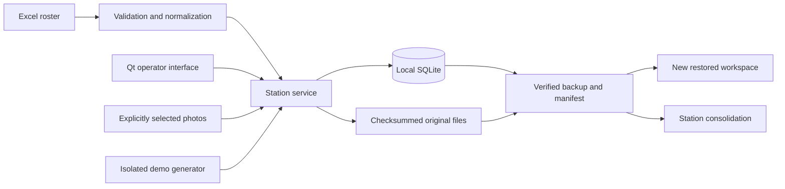

# Architecture

## Scope

This release targets independent Windows photo stations. The student-facing
selection website and additional camera brands are later work. The experimental
Canon USB connector awaits hardware validation. The desktop app starts empty;
demo and camera-test modes are explicit and isolated in separate workspaces.

## Modules

- `roster.py` reads legacy XLS and XLSX, extracts usernames from supported AUB email
  domains, validates identities, and preserves multiple program enrollments.
- `store.py` owns direct SQL, nested transactional savepoints, the schema version,
  and migration from the initial roster-only database.
- `service.py` is the backend used by the UI. It opens a dedicated database
  connection per operation, so file workers never reuse a UI-thread connection.
- `camera.py` defines an explicit session-bearing capture envelope and the future
  camera adapter boundary. Canon ingestion additionally requires a durable,
  session-bound transfer receipt.
- `canon_sdk.py` loads an external x64 EDSDK and owns native references, COM STA
  initialization, callbacks, Unicode downloads, and the camera's save destination.
- `canon.py` maps JPEG capture times to disjoint camera-clock session intervals.
- `camera_worker.py` serializes SDK commands and polling on one Qt worker thread.
- `camera_inbox.py` journals transfers and retains files requiring human review.
- `numbering.py` allocates durable general picture numbers shared across event
  workspaces in the same Windows user profile, with a separate demo ledger.
- `gui.py` provides the operator screens and background file/import/export tasks.
- `ui_theme.py` supplies a consistent light palette and explicit text colors so
  Windows dark mode cannot hide labels against light controls.
- `help_content.py` contains the built-in, numbered operator guide.
- `archives.py` validates backups, restores to new folders, and consolidates station
  exports with checksums and an atomic JSON index commit.

## Identity and eligibility

IDs are digit strings, retaining leading zeros when represented as text in Excel.
Usernames and emails are matched exactly after trimming and case normalization.
Supported roster email domains are `mail.aub.edu` and `aub.edu.lb`. No fuzzy name
match can select an active person. A repeated ID with consistent identity fields
may have multiple programs. Conflicting IDs/usernames stop the entire import.

Students have internal UUIDs. An official roster reimport preserves those keys,
updates the imported people, and replaces current roster eligibility. Historical
people and their sessions remain stored. A student absent from the current roster
cannot start a new session through the service.

Provisional people also have UUIDs, but may have unknown AUB identifiers. Internal
placeholder keys are never presented as genuine AUB IDs. An official import can
reconcile a matching provisional ID/username when unambiguous. Manual
reconciliation requires a reason, moves session associations to the official
student, and leaves an audit record. Identity corrections do not rewrite photo
bytes or filenames. Each session retains its original identity snapshot.

## Sessions and ingestion

The database permits at most one active/draining session in a workspace. Starting
a session requires explicit identity confirmation. Search does not change the
active session. Every ingestion request carries a specific session UUID; a late
request for a finished session fails instead of using the next active student.

Manual ingestion accepts user-selected or synthetic JPEG/PNG/TIFF files. The
experimental Canon path accepts JPEG and requires a bound transfer receipt.
It checks that the image decodes, reserves an asset UUID/sequence/path, copies to
a partial file, flushes to disk, verifies source stability and SHA-256, records
the staged checksum, publishes without replacing an existing file, then marks
the asset ready. User-selected files outside the camera inbox are never deleted;
verified camera intermediates are removed after asset commit. Filenames use the identity
snapshot, event timezone, millisecond time, station code, session sequence, and a
six-digit-minimum general picture number (`_P000001`). Schema v4 gives every
session an immutable `photo_directory`, for example
`originals/900000001_testcam1/2026-11-26_session-01`. The date uses the session's
start time in the event timezone. Allocation skips case-insensitive database
collisions and existing directories, so retakes and untracked files are separate.
The original identity snapshot supplies the folder label; later corrections do
not rewrite it. Student and session UUIDs remain database identifiers.

After startup recovery, the desktop organizes older saved photos into these
directories while holding the workspace lock. Each new copy is flushed and
checksum-verified before the asset's new path and cleanup audit are committed
together. Only then is the verified old duplicate removed. An interruption before
commit leaves the old link usable; one after commit leaves the new link usable.
Reopening resumes copying and audited cleanup. Empty old directories are removed;
failed imports, partial files, and untracked files remain for review. Missing,
changed, or conflicting files keep their existing links and produce a visible
review message without preventing the event from opening. Archives continue to
validate older databases and UUID paths; restored events upgrade on opening.

The general counter is an independent local SQLite ledger outside workspaces.
An immediate transaction serializes allocation across app processes. The allocated
number and numbering-machine UUID are also recorded with each asset and validated
in backups. The counter continues across students, sessions, workspaces, restarts,
updates, and event restores in the same Windows profile. Demo and camera-test imports never consume
production numbers. Failed allocations/saves can leave gaps; numbers are never
recycled. Schema v3 adds nullable numbering fields to preserve older assets and
filenames without guessing retrospective numbers.

A provided timestamp must include a timezone. Imports without one use receipt
time and explicitly record `time_source=received`. The Canon connector uses
camera-local EXIF time for ownership, but keeps receipt-time filenames because it
does not infer the camera timezone. RAW/JPEG grouping remains later work.

SQLite uses WAL, foreign keys, and FULL synchronous commits. On startup, incomplete
ingest jobs are reconciled against their journaled final paths and checksums.
Active sessions become `needs-review`; capture assignment never automatically
resumes. A failed import retains its source and any partial file for review.
Finishing a session with failed assets puts it in review. An operator can record
the review outcome without erasing failed asset records.

Qt locks prevent two app windows from opening the same workspace. Long-running
file operations run in workers; session transitions and closing/switching
workspaces are disabled while they run.

## Operator interface

The main window has Photoshoot, Students, and How to use tabs. History and event
management are in a separate Manage dialog; restore and consolidation are under
More backup options. First launch shows event setup followed by roster import,
and status messages describe the next required action.

The Photoshoot view displays one student at a time. Starting a session requires
the identity checkbox. While active, student search and selection are disabled,
and the identity card remains tied to the actual session. Editing a search clears
the previous lookup and identity confirmation. Finishing clears the card and
returns focus to search. These UI constraints supplement the backend's explicit
session ownership for ingestion.

Windows begin within the screen's available area. Scrollable content keeps
controls reachable on smaller laptop screens. The theme specifies foregrounds,
backgrounds, placeholders, table headers, and disabled states. The guide and
isolated demo are available before importing any real student data.

## Archives

Backup uses SQLite's backup API, not a raw copy of a live database file. It requires
no active session or pending import and includes ready photos, database, manifest,
and CSV summary. Before publication, it verifies archive contents, photo checksums,
database integrity/foreign keys, and agreement between database and manifest.
It never replaces an existing backup file.

Restore validates first, copies into a temporary sibling directory, verifies
photos, then renames to a new destination. No arbitrary archive paths are extracted.
Consolidation uses a local SQLite lock to prevent concurrent writers, preserves
station namespaces and all separate sessions, and groups canonical people by AUB
ID. Provisional identities remain distinct. Repeated exports are idempotent;
conflicting identifiers, reused export IDs, or stale station snapshots require
review. The atomic index update is the commit point, and verified orphan copies
from an interrupted merge can be reused on retry.

## Canon transfer boundary

The native SDK is optional and loaded only from the operator-selected x64 DLL
path. A single Qt thread initializes COM and EDSDK, owns callbacks and references,
polls events, downloads files, and performs student transitions. A per-profile
camera lock prevents competing Yearbook windows. Workspace switching and backup
are disabled until disconnection.

The connector requests SaveTo=Both, preserving the camera-card copy. Camera
controls are locked between sessions. Arming waits for a fresh camera-clock
second before enabling the physical shutter. Finishing locks controls, closes
that session's capture-time interval, and drains SDK transfer jobs. Disjoint
intervals plus original JPEG EXIF times prevent notification arrival order from
selecting the next student. Clock jumps stop the connection. Late closed-session
transfers, unsupported formats, and missing capture times require human review.

An inbox receipt is written before download. Bytes are flushed and checksummed
before EdsDownloadComplete; failures call EdsDownloadCancel. Ingestion requires
the receipt's explicit session binding and matching checksum. The verified
intermediate file is removed only after asset commit, with an audit association
that repairs a receipt interrupted after commit. Unassigned files remain local
and block event backups until explicitly recovered or marked handled. Event
backups contain saved assets; handled external files are not silently included.

SDK simulation validates application logic, not camera behavior. The connector
remains experimental until the hardware checks below and in `canon-testing.md`
pass with the actual camera/SDK/cable combination.

## Hardware validation gate

Do not implement a generic watcher that assigns files to whoever is displayed at
arrival time. A real adapter must carry capture-time identity context or prove
a session-specific destination and transfer-completion boundary. Quiet folders
and fixed delays do not establish that boundary.

Test the actual camera, cable, tethering software, and event laptop for shutter
operation, bursts, delayed files, RAW/JPEG if required, disconnect/reconnect, and
rapid student switches. A simulator or manual-import test does not pass this gate.

## Data boundaries

The public source/release contains no real student records, photos, database, or
Canon SDK files. Canon's external package is obtained separately under its terms.
Runtime workspaces and backups are private local artifacts. This release has no
network sync, analytics, authentication, or student gallery. The UUID-based
session/asset manifest will support a later authenticated selection platform.

## Windows packaging

Binary discovery runs with a restricted PATH containing the selected Python
installation and Windows system folders. This prevents unrelated installed tools
from supplying an incompatible ICU or UCRT DLL. MSVC runtime copies bundled with
Python/Qt are aligned to the newest bundled version before packaging. The portable
and installed application both run the synthetic self-test in the release workflow.
